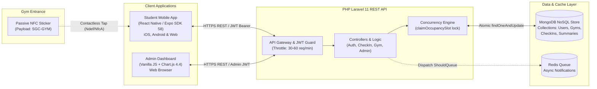
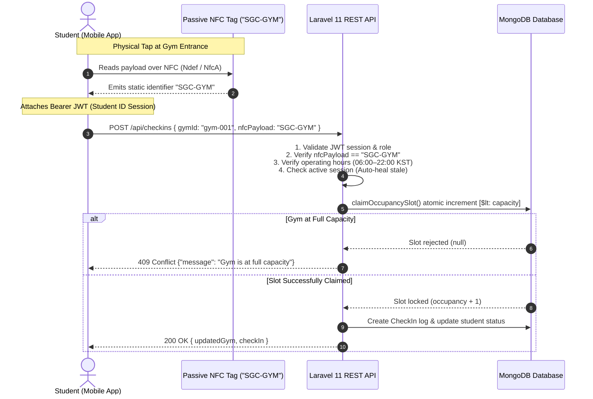

<!-- markdownlint-configure-file { "MD013": false, "MD033": { "allowed_elements": ["p", "img", "strong", "a", "details", "summary", "b"] }, "MD041": false } -->

<p align="center">
  
</p>

# Sejong Gym Check-in App (SGC)

<p align="center">
  <strong>Mobile-first gym capacity tracking and contactless NFC check-in/out for Sejong University.</strong>
</p>

<p align="center">
  <a href="https://expo.dev/"></a>
  <a href="https://reactnative.dev/"></a>
  <a href="https://laravel.com/"></a>
  <a href="https://www.php.net/"></a>
  <a href="https://nodejs.org/"></a>
  <a href="https://www.mongodb.com/"></a>
  <a href="https://redis.io/"></a>
  <a href="backend/tests"></a>
  <a href="backend/tests"></a>
  <a href="backend/tests/Feature/LatencyBenchmarkTest.php"></a>
  <a href="backend"></a>
  <a href="LICENSE"></a>
</p>

<p align="center">
  <a href="#-overview--problem-statement">Overview</a> •
  <a href="#-system-architecture--visual-proof">Architecture</a> •
  <a href="#-why-sgc-facility-access-comparison">Why SGC?</a> •
  <a href="#-key-features">Features</a> •
  <a href="#-tech-stack">Tech Stack</a> •
  <a href="#-60-second-fast-path">60s Fast Path</a> •
  <a href="#-quick-start">Quick Start</a> •
  <a href="#-demo-credentials--testing">Demo Accounts</a> •
  <a href="#-backend-api-contract">API Contract</a> •
  <a href="#-testing--verification">Testing</a> •
  <a href="#-troubleshooting--faq">Troubleshooting</a> •
  <a href="#-roadmap--progress">Roadmap</a>
</p>

---

## 🎯 Overview & Problem Statement

The Sejong University Gymnasium (Student Union Building B, 3F) is a core campus facility with a strict physical occupancy threshold (e.g. 50 occupants). During peak academic hours, students frequently face overcrowding, long entry queues, or arrive in gym attire only to be turned away because the room is at capacity. Manual sign-in sheets compromise student privacy, create recording overhead, and fail to provide real-time occupancy visibility.

**Sejong Gym Check-in (SGC)** replaces manual logs with an integrated full-stack solution:

- **Live Occupancy Tracking**: Students monitor real-time capacity and operating status before heading to the facility.
- **Frictionless NFC Tap**: Check in or out in seconds by simply tapping a passive NFC sticker placed at the entrance door.
- **Atomic Concurrency Control**: Single-document locks (`claimOccupancySlot()`) guarantee the gym never exceeds maximum capacity, even under simultaneous student arrivals.
- **Zero-Trust NFC Hardware Model**: Entrance stickers store zero student information; authentication and role permissions are validated exclusively through Bearer JWTs.
- **Admin Supervision & Analytics**: Facility managers supervise active occupants in real time, execute manual or bulk checkouts, and evaluate 7-day usage trends via Chart.js.

---

## 🔐 System Architecture & Visual Proof

### 1. High-Level System Architecture



---

### 2. Runtime NFC Tap & Concurrency Sequence



### Security & Privacy Invariants

1. **Zero Data on Sticker**: The passive sticker broadcasts exclusively the static ASCII payload `"SGC-GYM"`. It contains no database keys, student IDs, or counter state.
2. **Server-Enforced Authorization**: Student identity is derived exclusively from cryptographic Bearer JWT headers issued upon student login (`HS256`, 480m TTL / 20160m refresh TTL).
3. **Double-Tap & Race-Condition Immunity**: Check-ins are protected by a partial unique index (`uniq_active_checkin_per_student`) and MongoDB atomic single-document updates (`claimOccupancySlot()`), with automated multi-document transaction fallback detection (`Gym::supportsTransactions()`).

---

## ⚖️ Why SGC? Facility Access Comparison

| Capability / Factor | SGC (Passive NFC Sticker) | Traditional Turnstiles / Kiosks | Paper Sign-in Sheets | Static / Dynamic QR Displays |
| :--- | :--- | :--- | :--- | :--- |
| **Hardware Investment** | **$0.20** per sticker | $3,000 – $10,000 per gate | Negligible | $150 – $400 display hardware |
| **Student Privacy** | **Zero student data exposed** (JWT in app) | Card cloning / badge theft risk | **Zero privacy** (names & IDs visible to all) | Vulnerable to shoulder-surfing |
| **Real-Time Capacity** | **Instant live telemetry** (SSE + polling) | Live via proprietary server | **None** (requires manual headcounts) | Delayed web hooks |
| **Anti-Fraud / Anti-Spoof** | **Atomic server-side lock** + JWT session | Physical barrier | No verification (fake names) | High fraud risk (shared screenshots) |
| **Maintenance Burden** | **Zero power / Zero wiring** | Motor, sensor, and card wear | Constant restocking | Requires continuous power & screen upkeep |
| **Dev & Simulation Support** | **Built-in radar modal + DevPanel** | None (requires hardware testbed) | None | QR mockup generators |

---

## ✨ Key Features

### 🎓 Student Mobile Application (`/user`)

- **Secure Authentication**: Validated login with 8-digit Sejong University Student IDs and password credentials.
- **Live Capacity Gauge**:
  - Real-time occupancy counter (e.g. `24 / 50` spots occupied).
  - Color-coded progress bar with dynamic capacity states (`Open`, `Full`, `Closed`, `Maintenance`).
  - Background-aware auto-polling via custom `useLiveOccupancy` hook.
- **Interactive Radar Scanner Screen**:
  - Full-screen animated radar scan interface.
  - Native hardware detection via `react-native-nfc-manager` for `NfcTech.Ndef` and `NfcTech.NfcA`.
  - Graceful `nfc_unsupported` error feedback on devices without NFC hardware.
- **Embedded Simulation Panel (`DevPanel`)**:
  - Allows full end-to-end evaluation on emulators or web browsers without physical NFC tags.
  - One-tap scenario triggers:
    - `✓ Check-in Success` (Valid tag, increments gym count)
    - `✓ Check-out Success` (Valid tag, decrements gym count)
    - `✗ Invalid NFC` (Simulates unrecognized third-party NFC tags)
    - `✗ Already Checked In` (Simulates duplicate tap prevention)
    - `✗ Already Checked Out` (Simulates check-out without prior check-in)
- **Workout Streak & Profile Analytics**:
  - Dynamic computation of consecutive day workout streaks, total exercise hours, and weekly visits.
- **Dark & Light Mode**: Seamless theme switching with high-contrast accessibility tokens.

### 🖥️ Admin Facility Dashboard (`/admin`)

- **Role-Based Access Control**: Strict route protection on `/api/dashboard/*` (accessible exclusively by `admin` users).
- **"Inside Now" Roster & Instant Bulk Check-Out**:
  - Live table of currently checked-in students with duration inside (`minutesInside`).
  - Individual manual checkout buttons for immediate administrator action.
  - **"Check out all" bulk action button**: One-click modal to check out all active occupants and reset facility occupancy to 0.
- **7-Day Visual Analytics**:
  - Powered by Chart.js 4.4.
  - Daily check-in volume, unique visitor counts, average workout duration, and peak-hour analysis.
- **Live Facility Settings**:
  - Adjust facility capacity (1–500), operating hours (`open` and `close` times), and facility status (`open`, `closed`, `maintenance`).

### ⚙️ Backend & Concurrency Engine (`/backend`)

- **Atomic Occupancy Locking**: `claimOccupancySlot()` and `releaseOccupancySlot()` in `Gym.php` prevent race conditions during high-volume ingress.
- **Transaction & Standalone Fallback**: `Gym::supportsTransactions()` dynamically checks replica set / `mongos` support and falls back to atomic single-document updates with compensating release on standalone MongoDB instances.
- **Automated Closing & Stale Auto-Heal**:
  - Scheduled command (`sgc:auto-checkout`) automatically closes active sessions at 22:00 KST, preceded by closing reminders at 21:30 KST (`sgc:send-reminders`).
  - Stale session recovery in `CheckInController::store()` auto-expires sessions lasting ≥ 16 hours or originating from previous calendar dates.
- **Asynchronous Redis Queue Support**: Push notification dispatches (`SendFcmNotificationJob`, `SendCapacityAlertJob`, `UpdateDailySummaryJob`) implement `ShouldQueue` for sub-200ms API response latency.

---

## 🛠 Tech Stack

### Frontend Clients

| Component | Technology | Version | Purpose |
| :--- | :--- | :--- | :--- |
| **Mobile App** | React Native + Expo | Expo SDK 58 / RN 0.88 / React 19.3 | Student mobile interface (iOS, Android, Web) |
| **Navigation** | React Navigation | 7.0 | Tab & Stack screen management |
| **NFC Engine** | `react-native-nfc-manager` | ^4.2.0 | Native NDEF & NFC-A hardware reading |
| **Admin Portal** | HTML5 / CSS3 / Vanilla JS | ES2020 | Zero-build dashboard served on port 5500 |
| **Admin Charts** | Chart.js | 4.4.1 | Visual 7-day occupancy and peak-hour charts |

### Backend & Infrastructure

| Component | Technology | Version | Purpose |
| :--- | :--- | :--- | :--- |
| **REST API** | PHP Laravel Framework | 11.x | Core business logic, routing, and concurrency engine |
| **Runtime** | PHP (NTS, x64) | 8.5+ | Project-local PECL configuration (`php-conf.d`) |
| **NoSQL Database** | MongoDB | 6.0+ | Document storage, atomic slot locks, partial unique index |
| **Queue / Cache** | Redis (`predis/predis`) | ^2.2 | Asynchronous job queues (`notifications`, `analytics`) |
| **Push Gateway** | Firebase Cloud Messaging | 5.x | Automated student reminders & capacity alerts |
| **Testing** | PHPUnit | 11.5 | 35 feature and unit test suites (122 assertions) |

---

## 📁 Project Structure

```text
Sejong-Gym-Check-in-App/
├── LICENSE                           # MIT License definition
├── README.md                          # Repository front door & technical documentation
├── admin/                             # Admin Dashboard (Vanilla HTML/CSS/JS + Chart.js)
│   ├── css/styles.css                 # Theme variables, layouts, and bulk-checkout styling
│   ├── index.html                     # Dashboard markup and modal structures
│   └── js/                            # api, live, sessions (bulk checkout), settings, charts
├── backend/                           # Laravel 11 REST API
│   ├── app/
│   │   ├── Console/Commands/          # sgc:auto-checkout, sgc:send-reminders, sgc:seed
│   │   ├── Http/Controllers/          # Auth, CheckIn, Gym, Notification, Dashboard, User
│   │   ├── Http/Middleware/           # EnsureAdminRole, JwtMiddleware
│   │   ├── Jobs/                      # SendFcmNotificationJob, SendCapacityAlertJob
│   │   └── Models/                    # Gym (claimOccupancySlot), CheckIn, User, Notification
│   ├── config/                        # database (MongoDB/Redis), jwt, queue, app
│   ├── routes/api.php                 # Versioned REST API routes
│   └── tests/                         # PHPUnit test suites (Feature & Unit)
├── database/                          # MongoDB Database Artifacts
│   ├── init_db.js                     # Collection schemas ($jsonSchema) & partial unique indexes
│   └── seed.js                        # Standalone MongoDB seeder
├── scripts/                           # PowerShell automation runners
│   ├── run_phpunit.ps1                # Run full PHPUnit test suite with project-local PHP
│   ├── run_tests_e2e.ps1              # Run HTTP contract integration test
│   ├── seed_db.ps1                    # Deterministic database seeder (28 users, gym-001)
│   ├── setup_new_php.ps1              # One-time: PECL ext-mongodb and local php-conf.d setup
│   ├── start_admin.ps1                # Serve admin portal on port 5500
│   ├── start_api.ps1                  # Serve Laravel API on 0.0.0.0:8000
│   └── start_workers.ps1              # Run Redis queue background workers
└── user/                              # Student Mobile Application (React Native / Expo)
    ├── App.jsx                        # Root application component
    ├── app.json                       # Expo config & native NFC plugin declarations
    └── src/
        ├── components/                # CapacityCard, DevPanel, PrimaryButton, Header
        ├── hooks/                     # useLiveOccupancy (background-aware polling)
        ├── navigation/                # MainTabs, AppNavigator
        ├── screens/                   # HomeScreen, NfcScanScreen, HistoryScreen, ProfileScreen
        └── services/                  # api (client, auth, checkin, gym), nfc (nfcService)
```

---

## ⚡ 60-Second Fast Path

Need the full backend stack running in **one command**? Run this one-liner in PowerShell (Administrator / standard terminal):

```powershell
powershell -ExecutionPolicy Bypass -Command ".\scripts\setup_new_php.ps1; .\scripts\seed_db.ps1; .\scripts\start_api.ps1"
```

Once the API starts on `http://0.0.0.0:8000`, open a new terminal for the mobile client:

```bash
cd user && npm install && npm start
```

---

## 🚀 Quick Start

### Prerequisites

- [Node.js](https://nodejs.org/) (`v18.x` or `v20.x` LTS)
- [MongoDB](https://www.mongodb.com/) Community Server running on `127.0.0.1:27017`
- [PHP](https://www.php.net/) (`8.2+` or `8.5+` NTS x64)

---

### Step 1: Backend Setup & Seed Database

```powershell
# 1. Run one-time environment preparation (wires local php-conf.d & ext-mongodb)
powershell -ExecutionPolicy Bypass -File .\scripts\setup_new_php.ps1

# 2. Seed deterministic dataset (Creates 28 users, gym-001, 159 check-ins, 7 daily summaries)
powershell -ExecutionPolicy Bypass -File .\scripts\seed_db.ps1

# 3. Boot Laravel API server (Listens on 0.0.0.0:8000 for LAN & emulator access)
powershell -ExecutionPolicy Bypass -File .\scripts\start_api.ps1
```

> [!NOTE]
> The backend server binds to `0.0.0.0:8000`. The mobile client (`user/src/config.js`) dynamically detects your host's local Wi-Fi IP from `Constants.expoConfig.hostUri`, allowing seamless testing from physical mobile phones on the same network without editing `.env` files.

---

### Step 2: Start Student Mobile Application

Open a second terminal window:

```bash
cd user
npm install
npm run start
```

- Press `w` to launch instantly in your web browser.
- Press `a` to run on Android Emulator or `i` for iOS Simulator.
- Scan the printed terminal QR code with **Expo Go** on your physical smartphone.

---

### Step 3: Start Admin Dashboard

Open a third terminal window:

```powershell
# Serves the static admin dashboard on http://localhost:5500
powershell -ExecutionPolicy Bypass -File .\scripts\start_admin.ps1
```

Visit [`http://localhost:5500`](http://localhost:5500) and sign in using the Admin credentials below.

---

## 🔑 Demo Credentials & Testing

The database seed provides pre-configured student and admin accounts:

| Client Application / Role | Identifier (Student ID / Admin ID) | Password | Details / Assigned Permissions |
| :--- | :--- | :--- | :--- |
| **Student Mobile App** | `20241234` (Demo Student) | `password` | Department of Computer Engineering |
| **Student Mobile App (Alt)** | `20245678` (Active Occupant) | `password` | Pre-checked in for immediate checkout test |
| **Admin Dashboard** | `00000001` (Gym Admin) | `password` | Role: `admin` (Full facility supervision & settings) |

### Testing Check-in & Edge Cases via DevPanel

1. Sign in to the mobile app with `20241234` / `password`.
2. Tap **"Tap to Check In"** to open the animated radar scanner.
3. On web or simulator, expand the collapsible **DEV** panel on the Home screen to trigger test outcomes:
   - Tap **"Check-in Success"** to simulate scanning an `"SGC-GYM"` sticker. Live occupancy increments immediately.
   - Tap **"Check-out Success"** to finish the workout. The session log updates in the **History** tab.
   - Tap **"Invalid NFC"** to verify that third-party NFC tags are rejected gracefully.
   - Tap **"Already Checked In"** to verify duplicate session prevention.

---

## 📡 Backend API Contract

All endpoints are hosted at `http://127.0.0.1:8000/api`. The standard response envelope is `{ "status": "success" | "error", "message": string, "data": object | null }`.

### Public & Authentication Routes

| Method | Endpoint | Auth | Description |
| :--- | :--- | :--- | :--- |
| `POST` | `/api/auth/login` | None (Throttle: 30/m) | Login with `{ studentId, password }`. Returns JWT token. |
| `POST` | `/api/auth/refresh` | None | Refresh expired JWT token. |
| `GET` | `/api/auth/me` | Bearer JWT | Retrieve current authenticated user profile. |
| `POST` | `/api/auth/logout` | Bearer JWT | Invalidate active JWT token. |
| `GET` | `/api/capacity` | None | Get live capacity and occupancy for default gym (`gym-001`). |
| `GET` | `/api/gyms/{gymId}` | None | Get detailed gym metadata, operating hours, and status. |
| `GET` | `/api/gym/status/stream` | None | Server-Sent Events (SSE) stream for real-time capacity updates. |

### Check-in & NFC Operations

| Method | Endpoint | Auth | Description |
| :--- | :--- | :--- | :--- |
| `POST` | `/api/checkins` | Bearer JWT (Throttle: 60/m) | Process NFC check-in. Body: `{ gymId, nfcPayload: "SGC-GYM" }`. |
| `POST` | `/api/checkouts` | Bearer JWT (Throttle: 60/m) | Process check-out. Body: `{ gymId, nfcPayload: "SGC-GYM" }`. |
| `GET` | `/api/checkins/active` | Bearer JWT | Get authenticated student's active check-in session. |
| `GET` | `/api/checkins/history` | Bearer JWT | Retrieve student's paginated session history with durations. |

### Admin Management (`EnsureAdminRole`)

| Method | Endpoint | Auth | Description |
| :--- | :--- | :--- | :--- |
| `GET` | `/api/dashboard/gyms/{gymId}/summary/{date}` | Bearer JWT (`admin`) | Daily analytics summary (hourly histogram, peak occupancy). |
| `GET` | `/api/dashboard/gyms/{gymId}/weekly` | Bearer JWT (`admin`) | 7-day analytics trend for Chart.js dashboard. |
| `GET` | `/api/dashboard/gyms/{gymId}/active` | Bearer JWT (`admin`) | List of all students currently inside the gym. |
| `PATCH` | `/api/dashboard/gyms/{gymId}/settings` | Bearer JWT (`admin`) | Update `capacity` (1–500), `status` (`open`/`closed`/`maintenance`), or `openingHours`. |
| `POST` | `/api/dashboard/gyms/{gymId}/active/{userId}/checkout` | Bearer JWT (`admin`) | Manually force check-out an individual student. |
| `POST` | `/api/dashboard/gyms/{gymId}/checkout-all` | Bearer JWT (`admin`) | **Bulk action**: Force check-out all active occupants and reset occupancy to 0. |

> [!IMPORTANT]
> All `/api/dashboard/*` endpoints strictly require a JWT containing the `admin` role. Requests with student tokens receive HTTP `403 Forbidden`.

<details>
<summary><b>🔍 View Example JSON Payloads & Responses</b></summary>

#### Successful Check-In (`POST /api/checkins`)

**Request:**

```json
{
  "gymId": "gym-001",
  "nfcPayload": "SGC-GYM"
}
```

**Response (HTTP 200 OK):**

```json
{
  "status": "success",
  "message": "Check-in successful. Welcome to Sejong Gym!",
  "data": {
    "checkIn": {
      "userId": "user-20241234",
      "studentId": "20241234",
      "gymId": "gym-001",
      "checkInTime": "2026-11-26T10:00:00Z",
      "status": "active"
    },
    "gym": {
      "gymId": "gym-001",
      "name": "Sejong Main Gymnasium",
      "capacity": 50,
      "currentOccupancy": 25,
      "status": "open"
    }
  }
}
```

#### Full Capacity Conflict (`POST /api/checkins` - HTTP 409)

```json
{
  "status": "error",
  "message": "Gym is at full capacity. Please wait or try another facility.",
  "data": null
}
```

</details>

---

## 🧪 Testing & Verification

The SGC repository includes comprehensive automated test suites covering edge cases, race conditions, and response latency.

### Running PHPUnit Automated Tests

```powershell
# Runs 35 feature and unit tests via the project-local PHP environment
powershell -ExecutionPolicy Bypass -File .\scripts\run_phpunit.ps1
```

```text
PHPUnit 11.5.57 by Sebastian Bergmann and contributors.

Runtime:       PHP 8.5.11
Configuration: Sejong-Gym-Check-in-App\backend\phpunit.xml

...................................                               35 / 35 (100%)

Time: 00:03.412, Memory: 54.00 MB
OK (35 tests, 122 assertions)
```

### Verified Test Suites

- **`AuthTest`**: Token creation, password hashing, profile extraction, and role verification.
- **`CheckInTest`**: Valid check-in/out flows, occupancy increment/decrement, and capacity boundary checks.
- **`NfcEdgeCasesTest`**: Wrong NFC payloads, duplicate taps, stale session auto-healing (≥ 16 hrs), and after-hours check-in rejection.
- **`LatencyBenchmarkTest`**: Verifies that authenticated check-in operations respond in **under 200ms** (`MAX_ALLOWED_LATENCY_MS = 200.0`).
- **`AdminDashboardTest`**: Settings mutation, authorization barriers, and bulk checkout verification.

---

## 🛠️ Troubleshooting & FAQ

<details>
<summary><b>1. Port 8000 is already in use by another process</b></summary>

Pass a custom port directly to the PowerShell runner:

```powershell
powershell -ExecutionPolicy Bypass -File .\scripts\start_api.ps1 8022
```

Then update `API_PORT` in `user/src/config.js` or use the **Server settings** button on the Admin Dashboard sign-in screen to point to `http://localhost:8022/api`.

</details>

<details>
<summary><b>2. MongoDB Connection Failed (`No connection could be made`)</b></summary>

Ensure the MongoDB Windows service is active:

```powershell
Get-Service -Name MongoDB | Start-Service
```

Verify MongoDB is listening on default port `27017` using MongoDB Compass or `mongosh mongodb://127.0.0.1:27017`.

</details>

<details>
<summary><b>3. Mobile device cannot connect to backend over Wi-Fi</b></summary>

1. Ensure your physical phone and development PC are connected to the same Wi-Fi network.
2. In Windows Firewall, permit inbound TCP traffic on port `8000`.
3. SGC automatically discovers your local LAN IP using `Constants.expoConfig.hostUri`. If your PC has multiple network adapters (e.g. VirtualBox or WSL), specify your primary IPv4 address in `user/src/config.js`.

</details>

<details>
<summary><b>4. How do I test NFC without physical NFC stickers?</b></summary>

Expand the purple **DEV** panel at the bottom of the Student Mobile App home screen. The panel provides one-click triggers for all valid and invalid NFC scan scenarios directly inside Expo Go, iOS Simulator, Android Emulator, or Web browsers.

</details>

---

## 📍 Roadmap & Progress

- [x] Initial Expo React Native mobile application prototype.
- [x] Student authentication flow and session state management (JWT).
- [x] Live gym capacity card with dynamic status indicators (`Open`, `Full`, `Closed`, `Maintenance`).
- [x] Interactive animated radar NFC scanning interface with sound & visual feedback.
- [x] Interactive Developer Simulation Panel (`DevPanel`) for emulator and web testing.
- [x] Session history logging with duration formatting (`< 1m`, AM/PM timestamps).
- [x] Profile, workout streak, and notifications screen with dynamic statistics computation.
- [x] Backend development: Laravel 11 REST API & MongoDB `$jsonSchema` validation.
- [x] Concurrency locking: `claimOccupancySlot()` and `Gym::supportsTransactions()` standalone fallback.
- [x] Mobile & Backend Live Integration with dynamic LAN Wi-Fi host IP auto-resolution.
- [x] Background-aware real-time capacity polling hook (`useLiveOccupancy`).
- [x] Operating hours enforcement (06:00 — 22:00 KST) with scheduled auto-checkout (`sgc:auto-checkout`).
- [x] Admin web dashboard with live occupancy, Chart.js 7-day analytics, and settings controls.
- [x] Admin **Bulk Check-out** ("Check out all") feature to reset occupancy safely.
- [x] Upgraded mobile client to Expo SDK 58, React 19.3, and React Native 0.88.
- [x] Native hardware NFC integration via `react-native-nfc-manager` (NDEF & NFC-A).
- [x] Real-time Server-Sent Events (SSE) stream endpoint for instantaneous updates.

---

## 👥 Team & Responsibilities

| Team Member | Role | Core Deliverables |
| :--- | :--- | :--- |
| **Lim Jun Xian Jedrek** | Frontend Developer (Customer App) | React Native Mobile UI, Reusable Components, Radar NFC Modal, DevPanel Simulation |
| **Javo** | Frontend & Admin Developer | Admin Dashboard UI, Chart.js Analytics, Bulk Check-out Interface, Settings Panels |
| **Nik** | Backend & API Lead | Laravel 11 REST API, Atomic Concurrency Engine, JWT Auth, PHPUnit Test Suites |
| **Zafri** | Database, Security & QA Lead | MongoDB Schema Design, `$jsonSchema` Rules, Partial Unique Indexes, Security Auditing |

---

## 📄 License

This project is licensed under the terms of the [MIT License](LICENSE).
